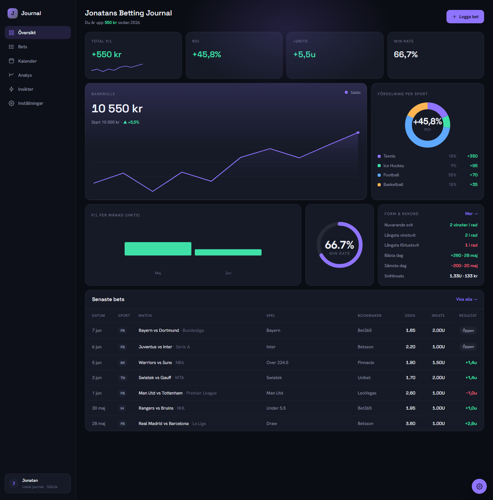
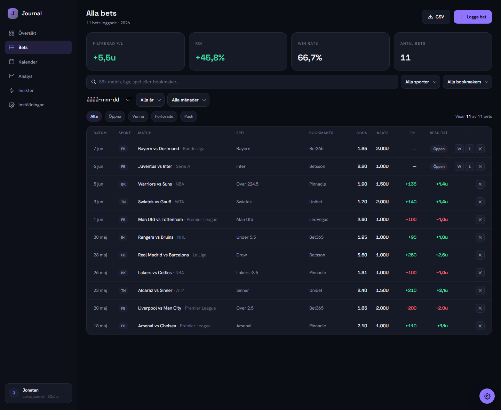
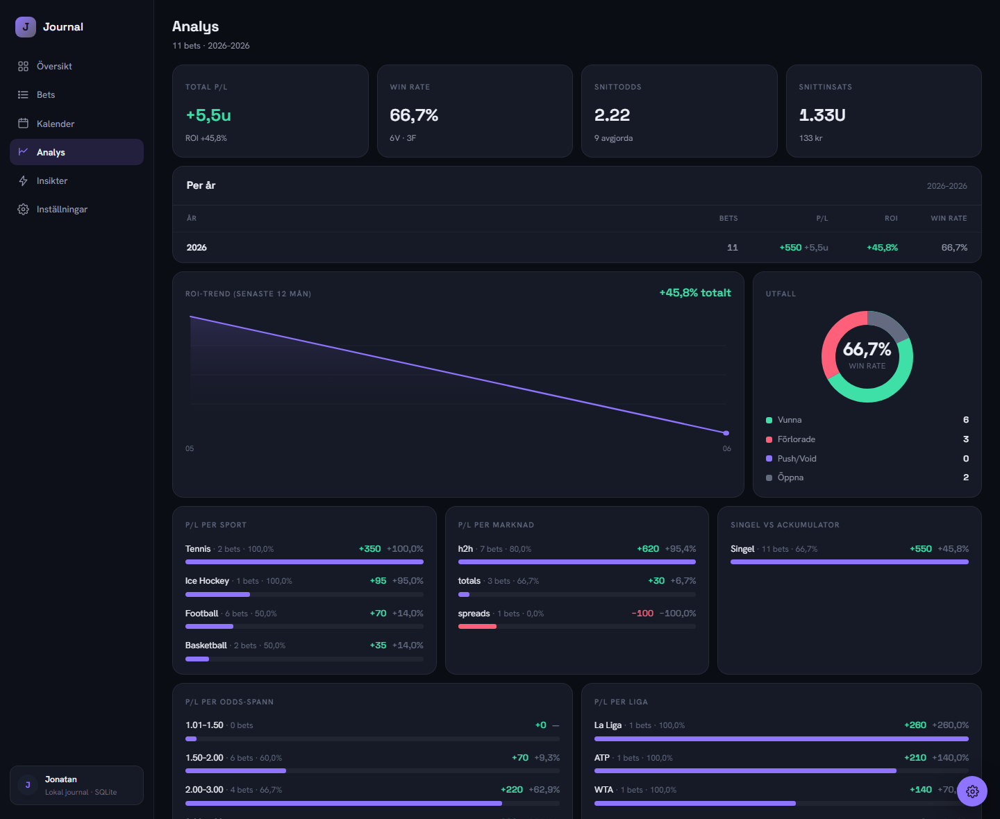

# 🎯 Betting Översikt

> A personal sports betting journal. Log bets in **units**, track **ROI** and
> **bankroll** over time, and **auto-settle** results from a bet365 account statement
> or The Odds API. Runs locally, or deployed to Vercel + Postgres as an installable
> PWA with per-account login.

<p align="left">
  
  
  
  
  
  
</p>

<p align="center">
  
</p>

---

## ✨ Features

- **Unit-based staking** with decimal (European) odds — `1U`, `1.25U`, `2.6U` …
  Unit value in your currency is configurable in Settings.
- **Dashboard** with bankroll-over-time curve, total P/L, ROI, win rate, sport
  distribution, monthly P/L bars and form/streak records.
- **Bet log** — add, edit, delete and quick-settle bets (Win / Loss / Push / Void),
  with CSV export.
- **Analytics** — profit & loss broken down by market, league, sport and odds band.
- **Insights & calendar** — streaks, best/worst days, average stake, and a calendar
  heatmap of results.
- **Auto-settling, two ways:**
  - Import a **bet365 account-statement PDF** — parses every slip and settles from the
    *actual payout* (after tax), never recomputed.
  - Optional **[The Odds API](https://the-odds-api.com/)** integration to grade finished
    events and pull closing odds for CLV.
- **Your own instance** — one Postgres database you control (Neon via Vercel, or any
  Postgres locally). Registration is gated behind an invite code and every query is
  scoped to the signed-in account, so accounts never see each other's bets.
- **Optional third-party calls** — grading and CLV use The Odds API and TheStatsAPI, and
  betslip screenshot import uses the Anthropic API. All three are opt-in: leave the key
  unset and the app simply falls back to manual entry.

## 🖼️ Screenshots

| Bet log | Analytics |
|---------|-----------|
|  |  |

## 🛠️ Tech stack

**Next.js 14** (App Router) · **TypeScript** · **Prisma + Postgres** (Neon) ·
**Tailwind CSS** · hand-rolled **SVG charts** · **Vitest** · **pdfjs-dist** (statement
parsing) · **Playwright** (local OddsPortal CLV scrape).

## 🚀 Quick start

> Requires **Node.js 18.18+** and a **Postgres** database. A free
> [Neon](https://neon.tech/) project is the quickest way to get one.

```bash
cp .env.example .env   # then fill in DATABASE_URL, DIRECT_URL and AUTH_SECRET
npm install            # install dependencies (once)
npm run db:push        # create the tables
npm run db:seed        # (optional) load demo bets so the dashboard isn't empty
npm run dev            # start the dev server
```

Open **http://localhost:3000**.

`db:seed` inserts a handful of **fictional demo bets** so you can explore the app
immediately — replace them with your own from the **Logga bet** button.

> 📱 **On your phone.** Deploy to Vercel + Neon Postgres and the app installs as a PWA,
> with per-account login (username + password, invite-code registration) so several
> people can each track their own bets. See **[DEPLOY.md](DEPLOY.md)**.

## 📜 Scripts

| Command | What it does |
|---------|--------------|
| `npm run dev` | Start the development server |
| `npm run build` / `npm start` | Production build / run it |
| `npm test` | Run the unit tests (Vitest) |
| `npm run db:push` | Create / sync the Postgres schema |
| `npm run db:seed` | Insert demo bets |
| `npm run db:studio` | Browse the database in Prisma Studio |
| `npm run sync` | Auto-settle finished bets + near-kickoff CLV (Odds API) |
| `npm run scrape:clv` | Batch OddsPortal CLV for featured markets (local) |
| `npm run capture:kickoff-clv` | Odds API near-kickoff closing capture |
| `npm run watch:kickoff-clv` | Daemon: auto-capture CLV T-30…T+5 |
| `npm run install:kickoff-clv-task` | Install Windows Task (every 10 min) |
| `npm run backfill:clv-scrape` | 90d OddsPortal CLV backfill (`--confirm`) |
| `npm run import:bet365` | Import / sync bets from a bet365 statement PDF |
| `npm run import:unibet` | Import bets from a Unibet transaction-history CSV |
| `npm run db:push:cs2` | Create / sync the CS2 schema (`CS2_DATABASE_URL`) |
| `npm run cs2:capture` | Check the HLTV parsers against live pages (local) |
| `npm run cs2:ingest` | HLTV → teams, rosters, matches, vetoes, map stats (local, `--confirm`) |
| `npm run cs2:demos` | Download + parse HLTV demos → demo facts (local, `--confirm`) |
| `npm run cs2:update` | Daily run: ingest + demos for upcoming matches + settle lines |
| `npm run cs2:backtest` | Walk-forward backtest of the CS2 model (`--save` → Facit tab) |
| `npm run backfill:bookmakers` | Fold bookmaker spelling variants onto one name (`--confirm`) |

## 🗂️ Pages

| Page | What |
|------|------|
| **Översikt** (Overview) | ROI, total P/L, win rate, bankroll curve, breakdowns |
| **Bets** | Full bet log — quick-settle, edit, delete, CSV export |
| **Kalender** (Calendar) | Calendar heatmap of daily results |
| **Analys** (Analytics) | P/L by market, league, sport and odds band |
| **Insikter** (Insights) | Streaks, best/worst days, averages |
| **VM 2026** | Tournament hub for bets tagged with the World Cup league |
| **Skottmodell** (Shot model) | Team-level shots & corners model, own database |
| **CS2** | Teams, players, per-map gameplan (T/CT), match pricing and props angles, own database |
| **NBA** | Player-based Monte Carlo simulation blended with the market (moneyline, spread, total), own database |
| **Fair odds** | De-vig, combo, correlation and Poisson calculators |
| **Verktyg** (Tools) | Cashout, hedge, Asian-handicap matrix, bonus value, Kelly |
| **Inställningar** (Settings) | Unit value, currency, starting bankroll, sync |

> The UI is in **Swedish** 🇸🇪 — it's a personal journal — but the codebase and docs
> are in English.

## 🔄 Auto-settling

### From a bet365 statement (no API needed)

Export your **account statement** as PDF, drop it in the project root as `statement.pdf`
(or point `BET365_PDF` at it), then:

```bash
npm run import:bet365                                  # dry-run: parse + print stats, DB untouched
npm run import:bet365 -- --confirm --user <username>   # incremental import into that account
```

It matches on each slip's reference, so it never wipes manually-added bets and is safe
to re-run. Profit comes from the **actual payout column**, after tax. Statement files
are git-ignored — they never leave your machine.

### From The Odds API (grading + near-kickoff CLV)

1. Get a free key (~500 requests/month) at <https://the-odds-api.com/>.
2. Copy `.env.local.example` → `.env.local` and set `ODDS_API_KEY=your_key`.
3. Restart the dev server. Then **Synka** (or `npm run sync`) settles finished H2H /
   totals / spreads bets and captures **near-kickoff** closing odds for linked events.

**Automatic pre-kickoff CLV (recommended):** install a Windows task that runs every
10 minutes and snapshots featured bets in the **T-30 … T+5** window:

```bash
npm run install:kickoff-clv-task
# or keep a terminal open:
npm run watch:kickoff-clv
```

Needs `ODDS_API_KEY`. Logs land in `.claude/logs/kickoff-clv.log`. New bets placed
inside the window are captured immediately on create.

### Automatic CLV via OddsPortal (local scrape batch)

Primary free CLV path for featured markets after kickoff (replaces TheStatsAPI when
you do not have that key):

```bash
npm i playwright
npx playwright install chromium

npm run scrape:clv -- --list                         # candidates only
npm run scrape:clv -- --confirm --limit 30            # post-kickoff batch
npm run backfill:clv-scrape -- --limit 50             # 90d backfill (writes DB)
```

Schedule `npm run scrape:clv -- --confirm` hourly via Task Scheduler. Per-bet refresh
in the UI still works. Prefers the bet’s bookmaker, then Pinnacle → bet365.

Requires local Node — not suited for serverless. Playwright keeps its Chromium in a
user-level cache outside the project, so it is never part of a serverless bundle: on a
Vercel deployment the per-bet CLV button is hidden and the endpoint answers `501
scrape_unavailable` rather than failing a browser launch. Manual closing odds and
`npm run scrape:clv` on your own machine both work as before. Props/niche markets may
need manual closing odds.

| Market | Auto-settled? |
|--------|---------------|
| H2H / Moneyline (incl. draw) | ✅ |
| Totals (Over/Under) | ✅ (exact line = push) |
| Spread / Handicap | ✅ (whole lines can push) |
| Other (BTTS, props, …) | ✍️ Settle manually |

## 🎮 CS2 module (`/cs2`)

A separate CS2 database (teams, players, matches, vetoes, per-map scoreboards and
facts parsed from demos), a per-map **GAMEPLAN** view per team and side, and a model
that prices map/match winner, handicaps, total rounds, total maps, pistol, first kill,
player kills/headshots and per-map kill duels (player vs player, tie = void) against
the lines you enter (by hand, from a screenshot, or fetched from Unibet/Kambi).

**Data flow**

```
HLTV (Playwright, your PC) → HTML cache (.cache/cs2/html) → parsers → CS2 DB
HLTV demos (.rar/.zip)     → demoparser2 → facts (.cache/cs2/demos/norm) → CS2 DB
CS2 DB → profiles · gameplan · ratings/veto/map/kill models → /api/cs2 → /cs2
```

**Setup (once)**

1. Set `CS2_DATABASE_URL` / `CS2_DATABASE_URL_UNPOOLED` in `.env.local` (see
   `.env.local.example`). Recommended: a separate Neon database (Custom Prefix
   `CS2` in Vercel). The same endpoint with `&schema=cs2` also works. **Never** point
   it at the bet log's schema: `db push` drops tables that are not in
   `prisma/cs2.prisma`.
2. `npm run db:push:cs2`
3. `npm i playwright && npx playwright install chromium` (as for the OddsPortal scraper).
   `npm i @laihoe/demoparser2` for demos (an optional native module).
4. `npm run cs2:capture`: checks every parser against live HLTV pages and prints a
   report. Any missing field means a selector needs fixing before you ingest.

**Running it**

```bash
npm run cs2:ingest                                 # dry-run: page budget only
npm run cs2:ingest -- --confirm                    # top 50 (VRS), last 6 months
npm run cs2:demos -- --confirm --upcoming --max-gb 20
npm run cs2:update                                 # daily: all of the above + settle lines
npm run cs2:backtest -- --save                     # model track record → Facit tab
```

Schedule `npm run cs2:update` once a day in Windows Task Scheduler. Every HLTV page is
cached on disk, so an interrupted run resumes where it stopped. A parser fix is applied
with `npm run cs2:ingest -- --confirm --reparse`, which needs no network. Demo archives
are deleted after parsing. The compressed facts stay in `.cache/cs2/demos/norm`, so new
metrics can be computed with `cs2:demos -- --confirm --reanalyze`.

**Caveats**

- Scraping and demo download run **locally only**. HLTV is behind Cloudflare and its
  terms do not allow scraping. Keep the default throttle (4–8 s per page) and page budget.
- The scripts use `patchright` (Playwright without the automation traces Cloudflare
  looks for) and your installed Chrome or Edge when available.
- The scripts open a visible browser window by default, because Cloudflare rarely lets a
  hidden one through. Click the check when it appears; `--headless` hides the window.
- If the Cloudflare check keeps coming back after a click, start your own Chrome or Edge
  with `--remote-debugging-port=9222` and set `CS2_CDP_URL=http://localhost:9222`
  (see `.env.local.example`).
- A series is ~0.3–1 GB of demos, so cap each run with `--max-gb`.
- The model needs real history before its prices mean anything. Run `cs2:backtest`
  and check the Facit tab. Until the map-winner log-loss beats 0.693 (coin flip) on a
  few hundred maps, treat the edges as hints, not bets.
- Books differ on overtime and on maps 1–2 rules. Set "inkl. OT" per line.

## 🏀 NBA module (`/nba`)

A player-based simulation of every NBA game. It produces our own prices for moneyline,
spread and total, blends them with the market and shows the edge against any price
(Pinnacle via OddsPapi, DraftKings via ESPN, or your own book's odds entered by hand).

**How the model works (`lib/nba/`, version nba-v2)**

0. **Team ratings** (`teamRatings.ts`). Offensive and defensive efficiency (points per
   100 possessions) and pace for every team, solved against the opponents each team has
   actually faced. Recent games weigh most (25-day half-life). They set 60 % of the
   scoring level and the pace; the player model below sets the other 40 % and adjusts for
   tonight's lineup against the lineup the rating was built on.
1. **Player rates** (`ratings.ts`). Each player gets per-minute rates (2PA, 3PA, FTA,
   turnovers, offensive rebounds) and shooting percentages from his recent games.
   Recent games weigh more, and each rate is shrunk toward his position's average.
2. **Minutes** (`minutes.ts`). Each player's recent average, adjusted by ESPN's injury
   list (Out = 0, Questionable = half) and then by your overrides on the match page.
   The rest of the roster is rescaled so the team plays 240 minutes.
3. **Team in this game** (`project.ts`). The players' rates, weighted by minutes, give
   the team's offence. It is adjusted for the opponent's defence, home court, back-to-backs
   and the usage/efficiency trade-off: a team missing its creators gets a penalty.
4. **Simulation** (`sim.ts`). 20 000 games, possession by possession, with overtime. A
   "rubber band" keeps the spread of the margin at NBA levels without moving the
   favourite's expected margin. The overall scoring level is calibrated to the league's
   actual points per possession.
5. **Picks in points** (`picks.ts`). The model's spread and total are compared with the
   market line, e.g. "model −7.2 vs market −6.5 → pick −6.5 (0.7)". The first line the
   model sees is locked (`NbaPick`) and never re-priced. Results and CLV are graded
   against that line and shown per edge bucket (all, 3+, 6+) in the Facit tab.
6. **Player props** (`props.ts`, `propsPipeline.ts`). Points, rebounds, assists, threes
   and PRA. Each player is simulated 5 000 times: minutes (±18 %), a nightly usage and
   shooting form, Poisson attempts and binomial makes, scaled by the game's pace and the
   opponent's defence. The match page shows the distribution over simulated nights
   against the line, every book's price and a field for your own book's line. The
   probability is blended 15 % with the de-vigged line, since no historical prop lines
   exist to backtest against. Props come from OddsPapi in the same request as the game
   odds, when your plan includes them.
7. **Pricing** (`pricing.ts`). The simulated probability is blended with the de-vigged
   market price (`priceTwoWay`, shared with CS2). Edge is EV per unit staked. Prices with
   edge ≥ 5 % at odds ≤ 4.0 are flagged.

**Data flow**

```
ESPN (free): scoreboard, box scores, injuries, DraftKings lines → NBA DB
OddsPapi: 1 request/day = every NBA game's prices (Pinnacle)     → NBA DB
NBA DB → ratings · minutes · simulation · blend → NbaProjection → /api/nba → /nba
```

**Setup (once)**

1. Set `NBA_DATABASE_URL` / `NBA_DATABASE_URL_UNPOOLED` in `.env.local` (own Neon
   database, or the CS2 endpoint with `&schema=nba`), plus `ODDSPAPI_KEY`.
2. `npm run db:push:nba`
3. `npm run oddspapi:discover`. It costs about 3 requests and writes
   `lib/oddspapi/ids.json`: the NBA tournament id, the basketball market ids and the
   football league ids for the next model. Check the output (especially that every market
   type was found and which books your plan includes), then commit the file.
4. `npm run nba:ingest`. It backfills from 2025-10-21 and takes about 15 minutes; it can
   be resumed.

**Running it**

```bash
npm run nba:update                    # daily: results, injuries, odds, projections, settle
npm run nba:closing                   # ~1 h before tip-off: injuries + closing odds
npm run nba:backtest -- --save        # walk-forward vs closing lines → Facit tab
npm run nba:backtest -- --param usageK=0.8 --param rubberBand=0.05   # try parameters
npm run nba:props-backtest            # props vs real box scores (no prop lines needed)
npm run nba:odds-history -- --from 2026-01-01 --confirm   # Pinnacle closing (free history)
```

Schedule both with `npm run install:nba-tasks` (Windows Task Scheduler): `nba:update`
daily at 13:00 (last night's results, tonight's lines) and `nba:closing` at 23:30,
before the first tip-off. Change the times with
`npm run install:nba-tasks -- -UpdateAt 12:00 -ClosingAt 23:00`. Logs go to
`.claude/logs/nba.log`. That is ~60 OddsPapi requests a month out of the free 250.

**Status and caveats**

- The backtest (1 026 games Dec 2025–Jun 2026 against DraftKings closing lines) shows
  the model does **not** beat a closing line yet. nba-v2 cut margin MAE from 11.77 to
  11.68 and total MAE from 16.0 to 15.64, against the market's 11.25 and 14.50. Picks
  against the closing line hit 48.9 % on spreads (break-even 52.4 %), and the market
  alone gives the lowest log loss. The blend weight is
  therefore 10 %, so the model nudges the market price rather than replacing it. Raise it
  (`DEFAULT_NBA_BLEND_W` in `lib/nba/params.ts`) only when a backtest says so.
- Props backtest (5 414 player-games in 342 games, Dec 2025–Jun 2026): the model beats each player's
  last-10 average on every stat, e.g. points MAE 4.99 vs 5.09 and log loss 0.669 vs 0.701
  at a line on that average. It cannot be tested against real prop lines yet.
- Edges mostly appear against soft prices, i.e. your own book's odds entered on the match
  page, when they differ from Pinnacle.
- The backtest knows which players played (as the injury list does before a real game),
  but not their minutes.

## 🧪 Testing

```bash
npm test
```

Covers profit/ROI/CLV math and auto-grading (win/loss/push/half/void, draws,
totals-push, spread half-lines), plus insights and score parsing.

## 📁 Project structure

```
app/            Pages + API routes (App Router)
components/     UI components and charts
lib/            betting.ts (math) · grading.ts (auto-settle) · bet365.ts (PDF parse)
                oddsApi.ts · sync.ts · insights.ts
lib/cs2/        CS2 module: hltv/ (scrape + parse) · demo/ (demo pipeline) ·
                ratings · veto · mapModel · killModel · pricing · backtest · settle
prisma/         schema.prisma + seed.ts (demo data) · shots.prisma · cs2.prisma
scripts/        sync.ts · importBet365.ts (CLI tools) · cs2/ (CS2 scripts)
tests/          Unit tests for the math and grading
```

## ⚠️ Disclaimer

This is a personal record-keeping tool, **not** betting advice and **not** a guarantee of
profit. Gamble responsibly, only with money you can afford to lose. If betting stops being
fun, seek help (in Sweden: [Stödlinjen](https://www.stodlinjen.se/), 020-81 91 00).

## 📄 License

[MIT](LICENSE) © Jonatan

---

<details>
<summary>🇸🇪 <strong>Svenska</strong> — klicka för svensk beskrivning</summary>

<br>

## 🎯 Betting Översikt

En **lokal** betting-journal. Logga bets i **units** med decimalodds, följ **ROI** och
**bankrulle** över tid, och **auto-rätta** resultat från ett bet365-kontoutdrag eller
The Odds API — allt på din egen dator, ingen inloggning, ingen molntjänst.

### ✨ Funktioner

- **Unit-staking** med decimalodds (`1U`, `1.25U`, `2.6U` …). Enhetsvärde i valuta
  sätts i Inställningar.
- **Översikt** med bankrulle-graf, total P/L, ROI, win rate, fördelning per sport,
  P/L per månad och form/svit-rekord.
- **Bet-logg** — lägg till, redigera, ta bort och snabb-rätta (Vinst/Förlust/Push/Void)
  med CSV-export.
- **Analys** — P/L per marknad, liga, sport och odds-band.
- **Insikter & kalender** — svit, bästa/sämsta dag, snittinsats och kalender-heatmap.
- **Auto-rättning på två sätt:** importera ett **bet365-kontoutdrag (PDF)** — vinst tas
  från den *faktiska utbetalningen* efter skatt — eller koppla på
  **[The Odds API](https://the-odds-api.com/)** för rättning + stängningsodds (CLV).
- **Din egen instans** — en Postgres-databas du äger. Registrering kräver inbjudningskod
  och varje konto ser bara sina egna bets.

### 🚀 Snabbstart

> Kräver **Node.js 18.18+**.

```bash
npm install        # installera beroenden (en gång)
npm run db:push    # skapa tabellerna (kräver DATABASE_URL i .env)
npm run db:seed    # (valfritt) lägg in demo-bets
npm run dev        # starta på http://localhost:3000
```

`db:seed` lägger in **påhittade demo-bets** så appen inte är tom — byt ut mot dina egna
via **Logga bet**.

### 🔄 Auto-rättning från bet365

Exportera ditt **kontoutdrag** som PDF, lägg det i projektroten som `statement.pdf`
(eller peka `BET365_PDF` på det):

```bash
npm run import:bet365                                       # dry-run: parsar + skriver statistik
npm run import:bet365 -- --confirm --user <användarnamn>    # inkrementellt in på det kontot
```

Matchar på varje slips referens — rör aldrig manuellt tillagda bets och är säker att
köra om. Kontoutdrag är git-ignorerade och lämnar aldrig din dator.

### 🔄 Auto-rättning via The Odds API

1. Skaffa en gratis nyckel på <https://the-odds-api.com/> (~500 anrop/mån).
2. Kopiera `.env.local.example` → `.env.local` och sätt `ODDS_API_KEY=din_nyckel`.
3. Starta om. **Synka** (eller `npm run sync`) rättar färdigspelade bets och fångar
   near-kickoff closing (`npm run capture:kickoff-clv -- --confirm`).

### Automatisk CLV via OddsPortal (lokal batch)

```bash
npm run scrape:clv -- --list
npm run scrape:clv -- --confirm --limit 30
npm run backfill:clv-scrape -- --limit 50
```

Schemalägg `npm run scrape:clv -- --confirm` varje timme (Task Scheduler). Per-bet
refresh i UI fungerar fortfarande.

Fungerar lokalt (`next dev`) — inte på serverless. Props/udda marknader kan kräva
manuell closing.

### 🎮 CS2 (`/cs2`)

En egen CS2-databas med lag, spelare, matcher, veton, scoreboards per karta och fakta
ur demos. Varje lag får en GAMEPLAN per karta och sida (T/CT), med docens rubriker.
En modell prissätter de linjer du lägger in för hand eller via skärmdump.

1. Skapa en egen Neon-databas i Vercel med Custom Prefix `CS2`, och lägg
   `CS2_DATABASE_URL` och `CS2_DATABASE_URL_UNPOOLED` i `.env.local`. Peka **aldrig**
   på speljournalens databas.
2. `npm run db:push:cs2`
3. `npm run cs2:capture`: kontrollerar parsrarna mot riktiga HLTV-sidor.
4. `npm run cs2:ingest -- --confirm` och sedan
   `npm run cs2:demos -- --confirm --upcoming --max-gb 20`.
5. Schemalägg `npm run cs2:update` en gång per dygn.
6. `npm run cs2:backtest -- --save` visar modellens facit under fliken Facit.

Skrapning och demos körs bara lokalt. HLTV:s villkor tillåter inte skrapning, så behåll
den låga takten. Lita inte på modellens edge förrän backtestet slår myntkast på några
hundra kartor.

### 🏀 NBA (`/nba`)

En spelarbaserad simulering av varje NBA-match. Den ger egna priser på vinnare, spread
och total, viktar dem mot marknaden och visar edge mot alla priser: Pinnacle via
OddsPapi, DraftKings via ESPN eller ditt eget bolags odds.

- Spelarnas takter (skott, straffar, turnovers, returer) viktas med förväntade minuter.
  ESPN:s skadelista sätter minuterna automatiskt, och du kan ändra dem på matchsidan
  och trycka **Simulera om**.
- Matchen spelas 20 000 gånger, possession för possession, med förlängning.

1. Lägg `NBA_DATABASE_URL`, `NBA_DATABASE_URL_UNPOOLED` och `ODDSPAPI_KEY` i `.env.local`.
2. `npm run db:push:nba` och `npm run oddspapi:discover` (cirka 3 anrop, en gång).
3. `npm run nba:ingest` läser in historik från ESPN, gratis.
4. Schemalägg `npm run nba:update` på morgonen och `npm run nba:closing` på kvällen.
5. `npm run nba:backtest -- --save` visar facit under fliken Facit.

Props (poäng, returer, assist, trepoängare, PRA) simuleras 5 000 kvällar per spelare.
Matchsidan visar fördelningen mot linjen, och fliken Props listar alla spelare.
Backtesten mot riktiga boxscores slår spelarens snitt på alla fem.

Ärligt läge: backtesten (1 026 matcher) visar att modellen inte slår DraftKings
stängningslinje än. Modellvikten är därför 10 %. Edges dyker främst upp mot mjukare
bolag som du matar in själv.

### ⚠️ Friskrivning

Detta är ett verktyg för att föra bok över egna bets — **inte** spelråd och **ingen**
garanti för vinst. Spela ansvarsfullt, bara för pengar du har råd att förlora. Om spelandet
slutar vara kul: [Stödlinjen](https://www.stodlinjen.se/), 020-81 91 00.

</details>
